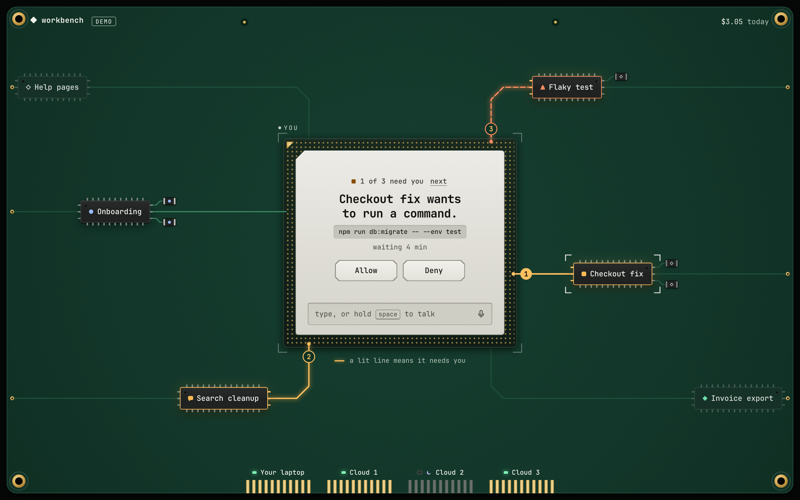

# Workbench

Workbench runs coding agents, such as Claude Code and Codex, each in its own git worktree, and shows what each one is doing in plain language. You answer them by typing or talking, then review their work and merge it.



*The board in the demo, where the agents and cloud machines are simulated.*

## Download and requirements

- The Mac app is on [GitHub Releases](https://github.com/coasty-ai/IDE/releases). It needs a Mac with Apple silicon and macOS 13.5 or later.
- Until the app is signed by Apple, macOS asks once before it opens it: System Settings → Privacy & Security → Open Anyway.
- It needs git. If git is missing, the app offers to install Apple's developer tools, which include it.
- It needs Claude Code or Codex. **Agents & keys**, in the app, helps you install one and sign in.

## First run

1. Open a git repository with **Open Folder…**. **Clone Repository…** copies one first, and **Try the Demo** shows simulated agents.
2. Connect an agent in **Agents & keys**. It opens by itself when no agent is ready.
3. Type what you want, such as "the login page is broken". Workbench asks before it starts an agent.

When the agent is done, review its changes, then merge them or throw them away. The full guide is [workbench/README.md](workbench/README.md).

## How it keeps you safe

- Each agent works in its own git worktree, on its own branch. Nothing reaches your branch until you merge it, and a merge always asks first.
- Claude Code agents wait for your OK before anything but reading, editing and git in their own folder, and a few safe commands such as tests. You see the exact command first. Codex agents never ask: they run in Codex's own sandbox.
- **Full permissions**, a button in the page's top band, stop the questions when you want agents to just get on with it. Turning them on asks first. While they are on, agents run every step without asking. Workbench still refuses changes to Claude Code's own settings, and helpers that would work elsewhere: edits are checked, and commands only on a best-effort basis (a patch such as `git apply`, code an interpreter runs, and names built at run time can get past it). They stay on, across restarts, until you turn them off.
- Each Claude Code agent has a spending limit: 2 US dollars, unless you set `--budget`. When one reaches it, the middle offers to give it one more, and only you can. Codex reports no cost, so Codex agents have no limit.
- Keys you give agents stay in your login keychain on a Mac, and are shown only as "•••• " and their last four characters.

Agents run as you, so the tests and scripts they run can do anything you can. [SECURITY.md](SECURITY.md) says what Workbench does not protect against.

## Run from source

You need Node 22 or later and git, on a Mac or Linux. There are no packages to install.

```sh
npm run demo      # simulated agents; nothing is spent
npm run dogfood   # real agents on this repository, on your own account
npm run app       # build the Mac app and put it in Applications
```

Real agents on another repository: `node workbench/bin/workbench.mjs --repo <folder>`. Building the app needs the Xcode command line tools.

## Not in this release yet

- Choosing the Claude model in the app (the command line has `--model`)
- A file view
- A pull or push button
- Real cloud machines: the demo only simulates them
- Windows
- The app on Intel Macs

## Development

- `npm test` runs the tests in about a minute. They start no real agents and need no network.
- [workbench/ARCHITECTURE.md](workbench/ARCHITECTURE.md) is the contract between the parts.
- [CLAUDE.md](CLAUDE.md) holds the rules, and [CONTRIBUTING.md](CONTRIBUTING.md) explains them for people.
- [CHANGELOG.md](CHANGELOG.md) says what changed in each version.

## License

MIT. See [LICENSE](LICENSE).
